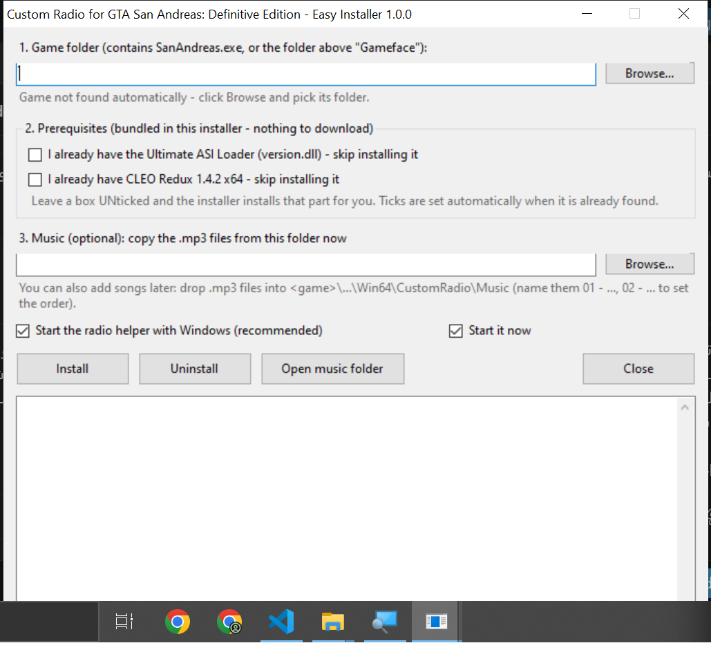

# Custom Radio for GTA San Andreas: Definitive Edition

Play **your own MP3 songs** while driving in *GTA San Andreas – The Definitive Edition* (PC).
Songs play **in order**, you can **skip / go back / seek**, and when you get out of the car and back in, the song
**continues from the same spot** (even after restarting the game).

Free and open source (MIT). One click: run **`easy_installer.exe`** - it even installs the prerequisites for you.



## Features

| | |
|---|---|
| Your own music | Drop `.mp3` files in a folder, they play in file-name order |
| Next / previous song | `Page Down` / `Page Up` |
| Seek | `Numpad 6` = +10 s, `Numpad 4` = -10 s |
| Pause / play | `Numpad 5` |
| Volume | `Numpad +` / `Numpad -` |
| Resume | Leave the car = pause, enter a car = continue from the same second. Saved to disk, survives game restarts |
| Pause menu / Alt+Tab | Music stops while the game is paused, in a menu or not in focus |
| Song name | Shown on screen when a song starts |
| Prerequisites included | CLEO Redux 1.4.2 and the ASI Loader are bundled in the installer - no separate downloads |

## Install (easy way)

1. Download **`easy_installer.exe`** from the [`dist`](dist/) folder (or the Releases page).
2. Double-click it. It finds your game automatically (or click **Browse** and pick the game folder).
3. **Prerequisites box:**
   - If you **already have** the Ultimate ASI Loader (`version.dll`) and/or CLEO Redux, tick the boxes ("I already have ... skip installing it"). They are ticked for you automatically when found.
   - If you don't have them, leave the boxes **unticked** - the installer installs them for you.
4. (Optional) Pick a folder with your `.mp3` files to copy them in right away.
5. Click **Install**.
6. In the game: set the in-game radio to **Off**, get in any car. Your music plays.

> **Tip:** the in-game radio must be **Off**, otherwise both would play at the same time.

### Adding songs later

Drop `.mp3` files into `<game folder>\Gameface\Binaries\Win64\CustomRadio\Music`
(the **Open music folder** button in the installer opens it). Name them `01 - ...`, `02 - ...` to choose the order.
New songs are picked up without restarting the game. You can put a number-prefixed name like `01 - Artist - Song.mp3`; the
number is hidden in the on-screen title.

### Uninstall

Run `easy_installer.exe` and click **Uninstall**. It removes the radio and the autostart entry and keeps your songs.
CLEO Redux and the ASI Loader are left in place because other mods may use them (delete `version.dll`, `cleo_redux64.asi`
and the `CLEO` folder yourself if you want them gone).

### Command line (optional)

```
easy_installer.exe /silent [/uninstall] [/gamedir:"C:\...\Game"] [/skipasi] [/skipcleo] [/music:"C:\My Songs"] [/noautostart] [/nostart]
```
`/silent` writes its log to `%TEMP%\custom_radio_installer.log`. (In Git Bash, set `MSYS_NO_PATHCONV=1` or use cmd/PowerShell,
otherwise `/silent` is rewritten as a path.)

## How it works

The game's own radio can't be extended on this build, and loading native code inside the game proved unstable, so the
radio is split in two and the risky part lives **outside** the game process:

```
GTA SA DE ── CLEO Redux ── custom_radio[fs].js        (tiny, uses only the official IniFile plugin)
                              │ writes "in car" + heartbeat to radio_bridge.ini
                              ▼
                      CustomRadio.exe  (hidden background helper)
                        - plays MP3 with Windows Media Foundation (WPF MediaPlayer)
                        - global hotkeys (only active while the game window is focused and you are driving)
                        - pauses when you leave the car / pause the game / Alt+Tab
                        - saves song + position to radio_state.ini
```

Files the installer puts in `<game>\Gameface\Binaries\Win64\`:

```
version.dll                      Ultimate ASI Loader (only if you didn't have it)
cleo_redux64.asi, CLEO\...       CLEO Redux 1.4.2 x64 (only if you didn't have it)
CLEO\custom_radio[fs].js         the in-game script
CustomRadio\CustomRadio.exe      the background helper (starts with Windows, idle when the game is closed)
CustomRadio\Music\               your songs
CustomRadio\backup\<time>\       copies of any file the installer had to overwrite
```

## What was tested

| Item | Result |
|---|---|
| Game build | GTA SA:DE **1.0.112.48699928** (PC), CLEO Redux **1.4.2 x64** (log reports host `1.0.112.6680`), ASI Loader **v10.0.2** |
| Test PC | Windows 11 (10.0.26200), .NET Framework 4.8.1. Installer built on Windows 10 LTSC 21H2 |
| Installer, clean folder (nothing installed) | OK - installs ASI Loader + CLEO Redux + radio, 2nd run changes nothing, uninstall keeps songs |
| Installer, real game folder | OK - game auto-detected, existing prerequisites auto-ticked, songs imported, autostart set, helper started |
| Playback of 7 real MP3s (different encoders/tags) | OK - every song opens, seeks +30 s, pauses and resumes (helper `--selftest`) |
| CLEO script loads in the game | OK - loads with no errors in `cleo_redux.log`, bridge file updates every 250 ms |
| In-game session with the final installer build | OK - music plays in a car with the game radio Off; next/previous song switching confirmed in the helper log; the author reported no problems with the rest of the session |
| Seek / pause / resume after leaving the car / resume after restart | Covered by the helper self-test (all 7 songs); please report anything odd in an issue |
| Steam / Epic / Rockstar-launcher builds | **Not tested.** The installer looks for `SanAndreas.exe`; if the folder layout differs, pick the folder that contains `SanAndreas.exe` |
| Other game builds (e.g. 1.0.113) | Not tested. The script uses only documented CLEO calls, no memory offsets, so it should be build-independent |

### Why not the "Mixtape" mod?

The Mixtape mod targets Steam build 1.0.113.21181 and patches game memory. On build 1.0.112 its scripts stop at start-up
(`unsupported station setter`), so the in-game radio just played the stock songs. This project does not touch game memory.

## Troubleshooting

- **No sound:** is the in-game radio set to *Off*? Is the helper running (`CustomRadio.exe` in Task Manager)? Are there `.mp3` files in `CustomRadio\Music`?
- **Helper log:** `CustomRadio\CustomRadio.log`. **Game script log:** `cleo_redux.log` next to `SanAndreas.exe` (look for `custom_radio`).
- **"Access denied" while installing:** close the game, or right-click `easy_installer.exe` -> *Run as administrator* (needed if the game is under `Program Files`).
- **Windows SmartScreen / antivirus warns about the exe:** it is unsigned and bundles DLLs. Build it yourself from source (below) and compare, or check the SHA-256 in `dist\easy_installer.exe.sha256`.
- **No Numpad on your keyboard:** open an issue; the keys are constants at the top of `src/CustomRadio.cs`.
- **Only `.mp3`** is scanned (top level of the `Music` folder).

## Build from source

Needs only Windows 10/11 (the C# compiler is part of .NET Framework 4.x) and internet on the first run.

```
build.bat          (or: powershell -ExecutionPolicy Bypass -File build.ps1)
```

This downloads the two prerequisite zips, **verifies their pinned SHA-256**, compiles the helper, then compiles
`dist\easy_installer.exe` with everything embedded.

```
src/CustomRadio.cs         background helper (player, hotkeys, resume)
src/custom_radio[fs].js    in-game CLEO Redux script
src/EasyInstaller.cs       the installer (WinForms)
build.ps1 / build.bat      build script
third_party/               licenses of bundled components
```

Helper self-test (plays every song silently, seeks, pauses, resumes; writes `selftest.log`):
`CustomRadio.exe --selftest`

## Legal

- No music or game files are included. Use your own legally obtained MP3s and your own copy of the game.
- This project is not affiliated with or endorsed by Rockstar Games or Take-Two. Mod at your own risk; keep backups of your saves.
- Bundled third-party components: **CLEO Redux** by Seemann (freeware license, redistributed unmodified together with its license - see `third_party/CLEO-Redux-LICENSE.txt`) and **Ultimate ASI Loader** by ThirteenAG (MIT). The installer places both license texts in `CustomRadio\licenses\`.
- The code of this repository is MIT licensed (see `LICENSE`).
